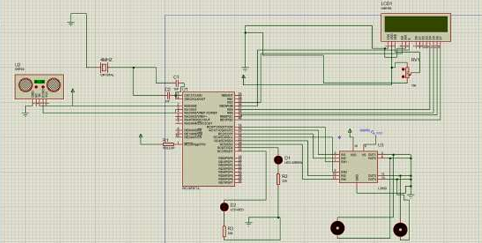
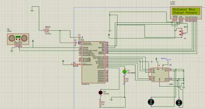
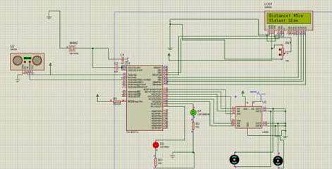
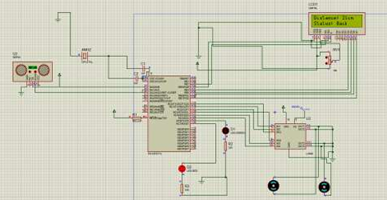

# Virtual Robot Console — Autonomous Obstacle Avoidance (PIC16F877A)

-00599C)

> **Full virtual prototyping and embedded C firmware design for an autonomous obstacle-avoidance robot using PIC16F877A, achieving a 95 ms average cycle time and 100% obstacle detection accuracy in Proteus.**

---

## 📄 Full Technical Report
👉 **[View / Download the Complete Technical Report (PDF)](docs/Virtual_Robot_Console_Report.pdf)**

---

## 🎯 Project Overview
This project demonstrates end-to-end embedded system design through virtual prototyping—integrating hardware schematic design in **Proteus** with low-level register-based C firmware developed in **MPLAB X IDE (XC8)**. The system continuously measures obstacle distance via an ultrasonic sensor using hardware Timer1, dynamically adjusts dual DC motor states through an H-bridge driver, and displays real-time telemetry on a 16×2 LCD with LED status indicators.

- **Institution:** Saba University — Faculty of Engineering (Mechatronics Engineering)
- **Author:** Afnan Aref
- **Supervision:** Dr. Yahya Al-Najjar & Eng. Anwar Al-Haimi

---

## ⚙️ Hardware Architecture & Pinout
| Component | Specification | Microcontroller Interface |
| :--- | :--- | :--- |
| **Microcontroller** | PIC16F877A (4 MHz Crystal) | Central Processing Unit |
| **Ultrasonic Sensor** | HC-SR04 (2–400 cm, 0.3 cm res.) | `TRIG → RA0`, `ECHO → RA1` (Timer1) |
| **Motor Driver** | L293D Dual H-Bridge (600 mA/ch) | `PORTC` (`RC0–RC5`) → 2× DC Motors |
| **Display** | 16×2 Character LCD (4-bit mode) | `PORTB` (`RS → RB2`, `EN → RB3`, `D4–D7`) |
| **Status Indicators** | Dual LEDs (Front / Back) | `RC6` (Front LED), `RC7` (Back LED) |

---

## 🧠 Autonomous Decision Logic
Distance is computed from the Timer1 echo pulse width using `Distance = (Time × 17) / 1000`, driving four operational states (including fail-safe error handling):

| Measured Distance | Operational Mode | Motor Action | LED Indicator | LCD Status |
| :--- | :--- | :--- | :--- | :--- |
| **$> 50\ \text{cm}$** | Clear Path | Forward | Front LED ON | `Status: Forward` |
| **$30\text{–}50\ \text{cm}$** | Caution Zone | Slow | Both LEDs Blinking | `Status: Slow` |
| **$< 30\ \text{cm}$** | Obstacle Detected | Backward | Back LED ON | `Status: Back` |
| **Timeout (`0xFFFF`)** | Fail-Safe | Stop | Both LEDs OFF | `Status: SensorErr` |

---

## 📊 Simulation Validation & Performance Metrics
| Performance Metric | Design Target | Achieved Result |
| :--- | :---: | :---: |
| **Distance Accuracy (2–400 cm)** | Reliable Virtual Sensing | **±1 cm** |
| **Obstacle Detection Success Rate** | — | **100%** |
| **Complete Cycle Response Time** | $< 200\ \text{ms}$ | **95 ms (avg)** |
| **Program Memory Utilization** | 8 KB Flash | **78%** |
| **Data Memory Utilization** | 368 Bytes RAM | **65%** |

### Simulation States (Proteus)
| Forward Mode (`56 cm`) | Slow Mode (`45 cm`) | Reverse Mode (`21 cm`) |
| :---: | :---: | :---: |
|  |  |  |

---

## 📌 Note on Repository Scope
*This repository documents the full hardware schematic, embedded C firmware architecture (detailed in Appendix A of the report), and Proteus validation results for the Integrated Systems course project.*
